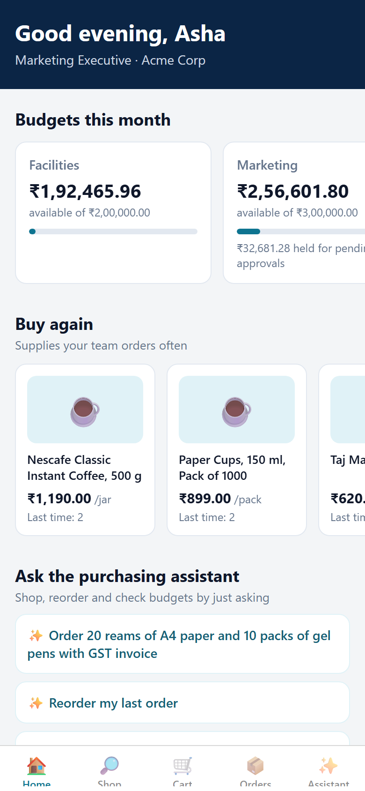
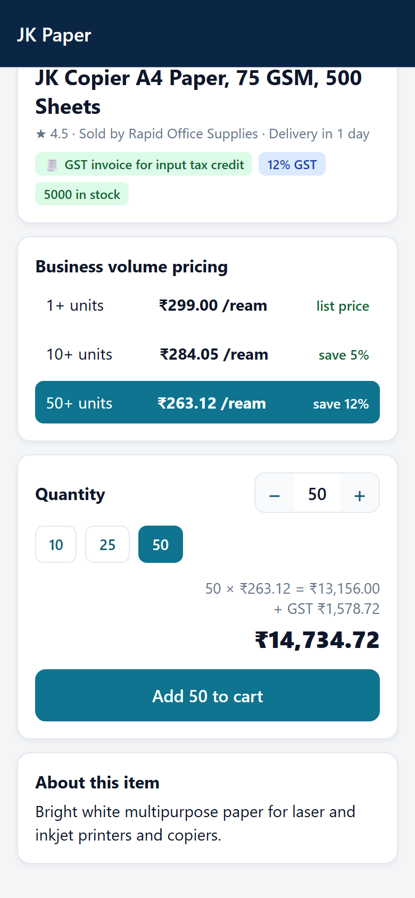
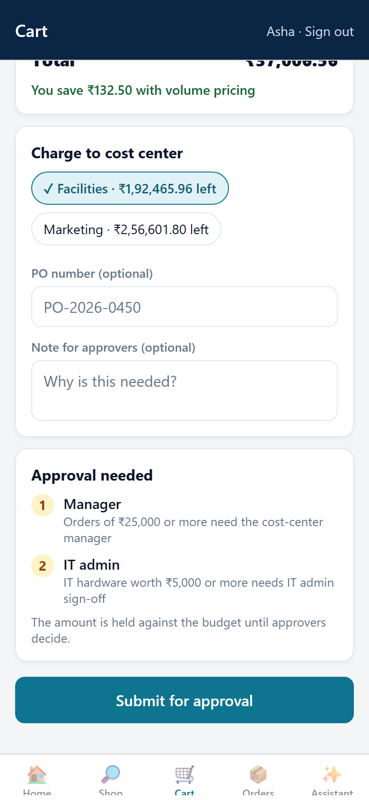
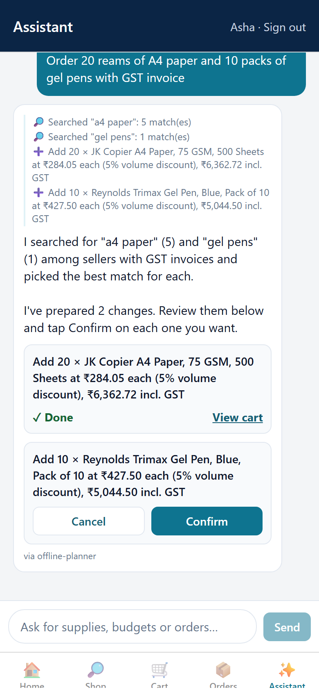
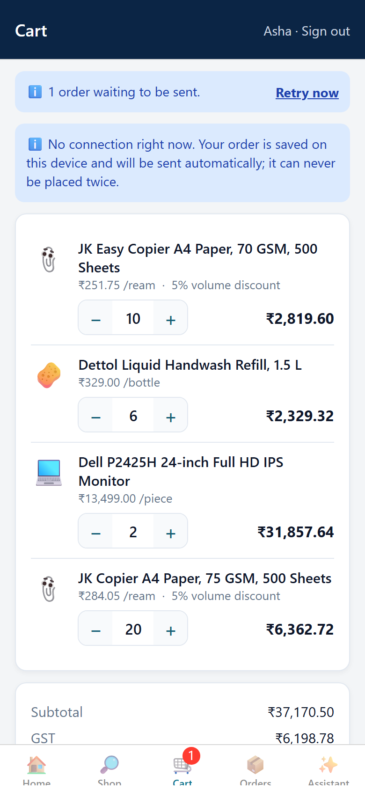
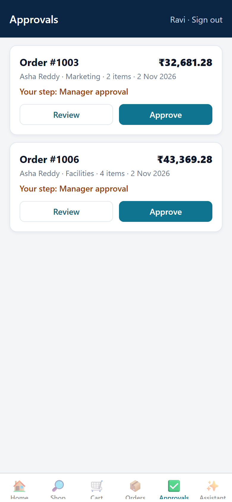
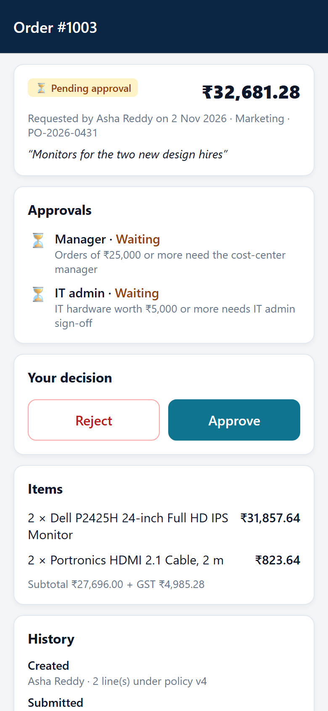
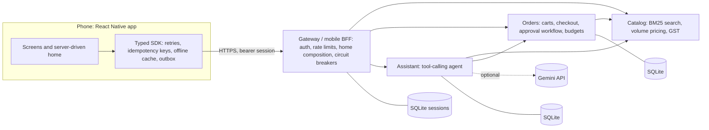
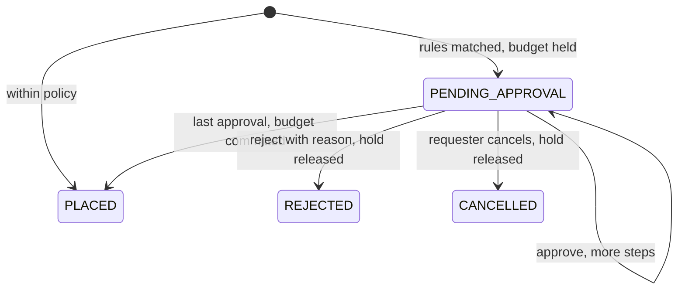

# ProcurePilot

[](https://github.com/yasaswinivardhireddy-png/procurepilot/actions/workflows/ci.yml)

A mobile shopping app for business buyers, with an AI purchasing assistant. It has three parts:

- a **React Native (Expo) app** for iOS, Android and web;
- a **typed TypeScript SDK** that the app and the tests share;
- **four Node.js microservices**: a mobile backend-for-frontend, catalog, orders with a config-driven approval workflow, and a tool-calling agent.

Buying for a business on a phone is different from buying for yourself. You spend company money under rules: approval chains, cost-center budgets, purchase-order numbers and GST invoices for input tax credit. You buy in bulk and reorder the same supplies, often from a warehouse or site with a poor connection. ProcurePilot is built around those constraints.

<p>
  
  
  
  
</p>
<p>
  
  
  
</p>

## Highlights

- **Mobile app.** Built with Expo Router: home, search with filters, product pages with volume pricing, cart and checkout, orders, an approvals queue for managers, and an assistant chat. Screens show saved data first and refresh in the background (stale-while-revalidate), so they open instantly and still work offline.
- **Checkout that survives bad networks.** Every checkout is written to an on-device outbox with an idempotency key *before* the first attempt. Timeouts, dropped connections, lost responses and app restarts replay the same key, and the server returns the original order instead of creating a second one.
- **Approval workflow as configuration.** A JSON policy (amount thresholds, IT-hardware rules, bulk quantities, over-budget orders) is validated at startup, hot-reloaded on change, and version-stamped on every order. A pure state machine runs the chain (manager → IT admin → finance) with budget holds and releases, optimistic concurrency and separation of duties.
- **Server-driven home screen.** The gateway decides which sections each role sees and in what order, behind percentage-rollout flags. The app tells the server which section types it can render, so older app versions never get a section they cannot draw. If one backend fails, only its section is dropped.
- **Agentic purchasing assistant.** A tool-calling loop over 8 tools: search, quote, budgets, cart, orders, add to cart, reorder and place order. Tool arguments are checked against JSON schemas. Anything that changes data becomes a proposal that the user confirms in the app, and confirming executes exactly once. Runs on Gemini function calling, or on a deterministic offline planner (also the fallback when the model is unavailable).
- **Built to be operated.** Prometheus metrics and JSON logs with request IDs in every service, plus health checks, timeouts, circuit breakers, per-session rate limiting, a fault-injection switch, and an audit endpoint that re-derives every budget from the orders.
- **No server dependencies.** The services are TypeScript run directly by Node.js 22 (type stripping), with Node's built-in SQLite and test runner.

## Architecture



Each service runs as its own process with its own database. Internal calls carry a shared service token and the user ID resolved by the gateway. Only the gateway is reachable from the app.



## Results

Measured on a Windows VM (AMD EPYC 7763, 32 logical cores, Node.js 22.23) with all four services running as separate processes. CI runs shorter versions of both tests on Ubuntu and Windows.

**Load test** (`npm run loadtest`): 64 virtual users for 20 s with a mobile-like mix of 30% home, 30% search, 15% product, 10% cart, 10% cart edits and 5% checkouts.

| Endpoint | Requests | p50 ms | p95 ms | p99 ms |
| --- | ---: | ---: | ---: | ---: |
| GET /v1/products?q= | 6,448 | 43.2 | 52.3 | 59.1 |
| GET /v1/home (fans out to 6 backend calls) | 6,338 | 76.8 | 90.6 | 98.5 |
| GET /v1/products/:sku | 3,250 | 43.2 | 52.9 | 59.9 |
| PUT /v1/cart/items/:sku | 3,167 | 58.8 | 81.3 | 91.8 |
| GET /v1/cart | 2,130 | 52.6 | 67.6 | 76.2 |
| POST /v1/orders (checkout) | 1,084 | 57.0 | 71.0 | 80.4 |
| **All requests** | **22,417** | **52.3** | **83.8** | **93.0** |

That is 1,120 requests/s through a single gateway process with 0 errors, and the budget audit balanced across 1,195 orders. Throughput is limited by the one gateway process, which can be scaled horizontally; latency is mostly queueing at 64 concurrent clients.

**Chaos test** (`npm run chaos`): 16 buyers place 320 orders through the SDK outbox while 30% of writes to the orders service fail. Half the failures happen before the change commits, half after it (the client never sees the response).

| Measure | Result |
| --- | ---: |
| Injected failures before commit | 146 |
| Injected failures after commit (response lost) | 146 (59 on checkout) |
| Checkout attempts sent by the SDK | 458 (138 failed) |
| Checkouts completed by an outbox replay | 30 |
| Retries answered from the idempotency store | 59 |
| Orders created | **320 of 320** |
| Duplicate orders | **0** |
| Budget ledger audit | balanced |

## How it works

### Exactly-once checkout from a phone

1. The cart screen sends the cart and total the buyer reviewed (`expectedItems`, `expectedTotal`) with the checkout. If the cart or prices changed meanwhile, checkout fails safely (`409 cart_changed` or `price_changed`) instead of charging something unexpected.
2. The SDK's `Outbox` saves the request and a fresh idempotency key to device storage, then sends it. Storage writes are serialized, so a slow write can never overwrite a newer one, and an entry that could not be saved is never sent. An entry left "sending" by a crash is replayed with the same key on the next launch.
3. The SDK retries network errors, `429` and `5xx` with exponential backoff and jitter. It honors `Retry-After` and reuses the same key and request ID on every attempt. Requests without a key, and non-idempotent ones, are never retried.
4. The orders service checks the key before doing any work and again inside the `BEGIN IMMEDIATE` transaction that writes the order. It stores the response in the same transaction, so a duplicate request gets the original order, and a reused key with a different body gets `422`. The order row keeps its key and request hash permanently (with `UNIQUE (user_id, idempotency_key)`), so even a phone that replays days later, after the general idempotency records expire, gets its original order back.
5. Services never retry writes themselves: retries happen at one layer, so they cannot multiply.

### Approval policy as configuration

```json
{
  "id": "it-hardware",
  "description": "IT hardware worth ₹5,000 or more needs IT admin sign-off",
  "when": { "categoryIn": ["IT & Electronics"], "totalAtLeast": 500000 },
  "requireRole": "IT_ADMIN"
}
```

Rules in [`server/config/approval-policy.json`](server/config/approval-policy.json) combine amount, category, quantity and budget conditions. Matches are merged per role and ordered by `roleOrder`. If nobody but the requester could approve a step (a manager buying for their own cost center), the step escalates to the policy's `escalationRole`, so no order can get stuck. Budget checks run inside the checkout transaction, so two concurrent orders cannot both slip under the remaining budget. An invalid edit is rejected and the last good policy stays active. Buyers see the required approvals before they submit (`POST /v1/orders/preview`).

### Server-driven home screen

`GET /v1/home` returns typed, versioned sections (`greeting`, `banner`, `budgetSummary`, `productCarousel`, `promptChips`, `categoryGrid`, `orderList`). The section list is driven by [`home-layout.json`](server/config/home-layout.json) per role and [`flags.json`](server/config/flags.json) for percentage rollouts. The app sends `x-sdui-capabilities: greeting@1,banner@1,...`. The gateway fetches only the data the chosen sections need, in parallel and each with a deadline, and caches catalog-wide sections for 30 seconds (serving the last value if a refresh fails). In the app, each section renders inside its own error boundary.

### The purchasing assistant

`runAgent` asks the model for the next step, validates and runs the requested tools in parallel, feeds the results back, and stops when the model answers or after 6 steps. Tool results are treated as data, not instructions. `add_to_cart`, `reorder` and `place_order` only create *pending actions* with a 10-minute expiry. The app shows each as a Confirm/Cancel card. Confirming claims the action atomically (`PENDING → EXECUTING`) before any network call, so a simultaneous Cancel cannot report success while the order goes through. Concurrent taps share one execution, and the action ID is the idempotency key downstream; if the outcome is unknown, confirming again replays it safely. A checkout proposal pins the exact cart, total and policy version the user saw. The Gemini adapter replays the model's own message parts, so thought signatures survive multi-step tool use. Without `GEMINI_API_KEY`, or if a model call fails, a deterministic planner speaks the same protocol.

## Quick start

Requires Node.js 22.18 or later.

```bash
npm start              # all four services; gateway on http://127.0.0.1:8080, demo data seeded
npm test               # 88 tests: unit, API, assistant, home-screen and chaos

cd mobile
npm install
npm start              # Expo dev server: press a (Android), i (iOS) or w (web)
npm test               # component tests
```

To use the app from a phone on the same Wi-Fi, start the services with `HOST=0.0.0.0 npm start`. To serve the web build from the gateway, run `npm run build:web` before `npm start` and open http://127.0.0.1:8080. To use Gemini, set `GEMINI_API_KEY` (and optionally `GEMINI_MODEL`, default `gemini-3.5-flash`).

Demo users: `u_asha` and `u_vikram` (requesters), `u_ravi` and `u_neha` (managers), `u_kiran` (IT admin) and `u_meera` (finance).

Other scripts: `npm run loadtest`, `npm run chaos` and `npm run screenshots` (regenerates the images above with headless Chrome or Edge). `npm run typecheck` checks the services, SDK and tests.

## API overview (gateway)

| Area | Endpoints |
| --- | --- |
| Session | `GET /v1/auth/demo-users`, `POST /v1/auth/demo-login`, `POST /v1/auth/logout`, `GET /v1/me` |
| Home | `GET /v1/home` (server-driven UI) |
| Catalog | `GET /v1/products?q=&category=&gstInvoice=&maxUnitPrice=&sort=&cursor=`, `GET /v1/products/:sku`, `GET /v1/categories`, `GET /v1/deals` |
| Cart | `GET /v1/cart`, `PUT /v1/cart/items/:sku`, `POST /v1/cart/items` (Idempotency-Key), `DELETE /v1/cart` |
| Orders | `POST /v1/orders/preview`, `POST /v1/orders` (Idempotency-Key required), `GET /v1/orders`, `GET /v1/orders/:id`, `POST /v1/orders/:id/{approve,reject,cancel,reorder}`, `GET /v1/approvals`, `GET /v1/budgets`, `GET /v1/buy-again` |
| Assistant | `POST /v1/assistant/turns`, `POST /v1/assistant/actions/:id/{confirm,cancel}` |
| Operations | `GET /healthz` and `GET /metrics` on every service; `GET /internal/audit` on orders |

Errors use one shape everywhere: `{ "error": { "code", "message", "details", "requestId" } }`.

## Project layout

```text
mobile/              React Native app (Expo Router): app/ screens, src/ session, outbox, cache hook, SDUI renderer
sdk/src/             Typed client, errors, retry/backoff, response cache, outbox, INR formatting
server/src/gateway/  Mobile BFF: sessions, rate limiting, home composition, static web hosting
server/src/catalog/  Seed catalog, BM25 search index, volume and GST pricing
server/src/orders/   Policy engine, workflow state machine, SQLite store, routes
server/src/assistant Agent loop, tools, Gemini and offline providers, pending actions
server/src/shared/   HTTP router, metrics, logging, circuit breaker, rate limiter, validation, fault injection
server/config/       Approval policy, home layouts, feature flags
tests/               node:test suites;  scripts/  load, chaos and screenshot tools
```

## Design notes and trade-offs

- **One retry layer.** The app (SDK and outbox) owns retries for writes. The gateway retries only idempotent reads, once. Retrying at every hop multiplies traffic during an outage.
- **Failure-rate circuit breaker.** A breaker that opens after N consecutive errors tripped under a steady 30% error rate in the chaos test. The breaker now uses a sliding window (open at a 50% failure rate over 50+ calls, or 10 failures in a row), and only the single trial call decides when a half-open circuit closes. When it is open, the gateway returns `Retry-After`, which the SDK and outbox honor.
- **Abuse limits.** Each session has a token-bucket rate limit, and failed sign-ins are throttled per IP address, so guessing tokens is slow and cheap to reject.
- **Budget holds instead of later checks.** Pending orders reserve budget immediately, so approvers see real availability, and rejection or cancellation releases it. `GET /internal/audit` recomputes both totals from the orders.
- **Demo sign-in.** Sessions are random tokens stored as SHA-256 hashes. A real deployment would use OIDC (for example Amazon Cognito or Microsoft Entra ID) and per-tenant data isolation.
- **On AWS** the same design maps to API Gateway with a Lambda or ECS BFF, DynamoDB conditional writes for idempotency and optimistic locking, Step Functions for long-running approvals, SQS/EventBridge for notifications, and CloudWatch for the metrics above.

## License

MIT
